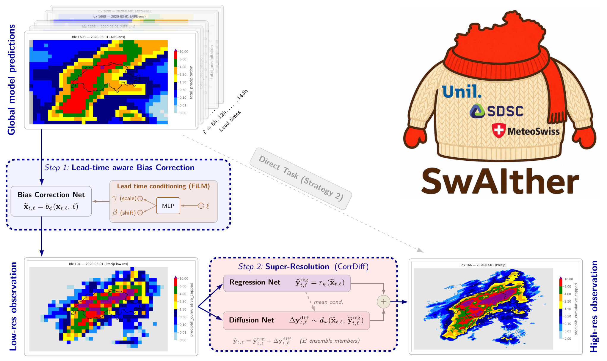

<div align="center">
  
# SwAIther-Precip: Lead-Time-Aware Bias Correction Enables Kilometer-Scale Downscaling of Global AI Precipitation Forecasts over Switzerland

[](https://arxiv.org/abs/2605.16163)
[](https://www.python.org/)
[](https://pytorch.org/)
[](https://github.com/NVIDIA/physicsnemo)
[](https://www.apache.org/licenses/LICENSE-2.0)

</div>

This repository contains the code and configurations for **SwAIther-Precip**, a two-stage downscaling framework that converts coarse-resolution AIFS forecasts into probabilistic km-scale precipitation fields over Switzerland.

## Wind pipeline

The repository also includes an independent hourly 10 m wind workflow. Step 1
is a deterministic six-hour-history U-Net with one-hour-ahead output and six-step
autoregressive inference. Step 2 retains the CorrDiff regression U-Net and EDM
residual diffusion structure while changing the physical fields to signed
two-channel `u10/v10` wind. Training uses 2019-2022, validation uses 2023, and
testing uses 2024.

All wind artifacts, checkpoints, conditions, statistics, logs, and caches are
stored below `/data62T/dengxian/swaither-precip/`. See
[`docs/wind_pipeline.md`](docs/wind_pipeline.md) for data contracts, commands,
GPU memory-probe guidance, output dimensions, evaluation, and known limitations.
The existing precipitation workflow remains available unchanged.

The pipeline consists of:

1. **Step 1 — Lead-time-aware bias correction.** A FiLM-conditioned U-Net that learns a deterministic residual correction on top of the raw AIFS precipitation channel, with the conditioning vector parameterized by forecast lead time.
2. **Step 2 — Generative super-resolution.** A CorrDiff-style two-component model (deterministic regression U-Net + conditional EDM diffusion U-Net) that generates fine-scale spatial variability on a 1 km grid, conditioned on the bias-corrected Step-1 output.


<p align="center">
  
</p>

For a full description of the methodology, evaluation, and results, see the paper: [SwAIther-Precip: Lead-Time-Aware Bias Correction Enables Kilometer-Scale Downscaling of Global AI Precipitation Forecasts over Switzerland](https://arxiv.org/abs/2605.16163).

> **Built on CorrDiff.** SwAIther-Precip extends NVIDIA's
> [CorrDiff](https://github.com/NVIDIA/physicsnemo/tree/main/examples/weather/corrdiff)
> implementation in PhysicsNeMo. Many of the training scripts, configuration
> schemas, model components (e.g. the EDM diffusion U-Net, the regression
> U-Net, patch-based training), and Hydra setup are adapted directly from
> CorrDiff. If you are looking to understand the lower-level Step-2
> mechanics or want general guidance on dataset registration, normalization,
> distributed training, or sampler choice, the CorrDiff documentation is
> the authoritative reference.

---

## Repository structure

```
swaither-precip/
├── conf/                                                                # Hydra training & inference configs
│   ├── config_training_aifs_single_lt_aware_FiLM_Time_regression_STEP1.yaml   # Step 1 main FiLM model (λ=2, multi-lead)
│   ├── config_training_aifs_single_regression_STEP1.yaml                      # Step 1 single-lead baseline
│   ├── config_training_aifs_single_regression_DirectStrat2.yaml               # Strategy 2 ablation
│   ├── config_training_aifs_single_regression_STEP2.yaml                      # Step 2 regression
│   ├── config_training_aifs_single_diffusion.yaml                             # Step 2 diffusion
│   ├── config_generate_aifs_single.yaml                                       # Generation (Step 2 only)
│   ├── config_inference_full_pipeline.yaml                                    # Full pipeline inference (Step 1 + Step 2)
│   ├── config_training_custom.yaml                                            # Upstream template (custom dataset)
│   └── config_generate_custom.yaml                                            # Upstream template (custom dataset)
├── swaither/                             # Importable package
│   ├── datasets/                         # Custom xarray-backed dataset classes
│   ├── models/                           # Bias-correction model definitions
│   ├── helpers/                          # Training, metrics, viz utilities
│   └── losses/                           # Temporal-consistency loss
├── scripts/                              # Entry points
│   ├── train_weekly.py                   # Train with rolling weekly split (default)
│   ├── train_yearly.py                   # Train with year-based train/test split
│   ├── generate_super_resolution.py      # Run Step 2 on bias-corrected inputs
│   ├── inference_full_pipeline.py        # Full inference: AIFS → Step 1 → Step 2
│   └── spectral_evaluation.py            # Spectral metrics on generated samples
├── notebooks/
│   ├── 01_data_preparation.ipynb         # Build training datasets from raw inputs
│   ├── 02_step1_evaluation.ipynb         # Evaluate bias-correction models
│   ├── 03_step2_evaluation.ipynb         # Evaluate super-resolution outputs
│   ├── 04_supplemental_sanity_checks.ipynb
│   └── 01_normalization_stats.ipynb      # Compute per-channel normalization stats
└── docs/
    ├── data_preparation.md               # How to obtain and prepare the data
    └── reproducing_paper.md              # Commands to reproduce paper results
```

Additionally, `containers/` contains the recipe for a reproducible
Singularity container image (see [Installation](#installation)).

---

## Installation

We provide three installation paths. **For HPC clusters and reproducible
deployments, the Singularity container is recommended.** For laptops or
dev workstations, the conda environment is the easiest standalone option.

### Option 1: Singularity (recommended for HPC and reproducibility)

A self-contained container image is provided that includes a fixed PhysicsNeMo
version, CUDA-enabled PyTorch (via NVIDIA's official PyTorch base image), and
all geospatial system libraries. The recipe supports both x86_64 and aarch64
(NVIDIA GH200) architectures:

```bash
git clone https://github.com/garelicu/swaither-precip.git
cd swaither-precip

# Build (requires Singularity / Apptainer 3.5+)
singularity build --fakeroot swaither_precip.sif containers/swaither_precip.def
```

See [`containers/README.md`](containers/README.md) for full instructions,
including how to use the image interactively, via SLURM, and how to adapt
the recipe for Docker.

### Option 2: Conda (recommended for laptops / dev workstations)

The geospatial dependencies (`cartopy`, `rioxarray`, `rasterio`) and CUDA-enabled PyTorch are easier to install via conda than via pip alone:

```bash
git clone https://github.com/garelicu/swaither-precip.git
cd swaither-precip
conda env create -f environment.yml
conda activate swaither-precip
```

You may need to adjust the `pytorch-cuda` version in `environment.yml` to match your CUDA driver. For CPU-only installation, remove the `pytorch-cuda` line.

### Option 3: pip-only (fallback)

```bash
git clone https://github.com/garelicu/swaither-precip.git
cd swaither-precip
python -m venv venv
source venv/bin/activate
pip install -r requirements.txt
```

⚠️ If the install fails on `cartopy`, `rioxarray`, or `rasterio`, your system is missing GEOS / PROJ / GDAL. Either install those system libraries (`apt install libgeos-dev libproj-dev libgdal-dev` on Debian/Ubuntu) or switch to one of the other installation paths above.

### A note on PhysicsNeMo

This project depends on NVIDIA's [PhysicsNeMo](https://github.com/NVIDIA/physicsnemo) (formerly known as **Modulus**, renamed in 2024). The PyPI package is `nvidia-physicsnemo`, but the Python import name is `physicsnemo` — both are reflected in our installation files. Older tutorials and forum posts may reference `nvidia-modulus`; that package is deprecated. The code in this repository was developed and tested against **PhysicsNeMo 1.2.0**, which is what we pin to. Compatibility with newer versions is not guaranteed.

---

## Quick start

### 1. Set up data

Obtain the required input datasets and place them (or a symlink) at `./data/` in the repo root. The expected files and how to obtain them are described in [`docs/data_preparation.md`](docs/data_preparation.md):

```bash
ln -s /path/to/your/data ./data
```

Then, the preprocessing pipeline can be performed using the `01_data_preparation.ipynb` notebook.
Its steps transform the raw inputs into the training-ready NetCDF files referenced by the configurations under `conf/`.

> **Adapting to your own data?** Each config references a normalization-stats
> JSON file in `./data/stats/`. The shipped configs assume the stats computed
> on our 2019–2023 training subset; if you train on a different dataset (or
> change the channel list), **compute new stats for your data** before
> training using
> [`notebooks/01_normalization_stats.ipynb`](notebooks/01_normalization_stats.ipynb).
> See [`docs/data_preparation.md`](docs/data_preparation.md#normalization-statistics)
> for the file format and conventions.

### 2. Train

Two training scripts are provided that differ only in the train/test split strategy:

- `scripts/train_weekly.py` — rolling weekly split (6 days train, 1 day test, repeating). Used for the main results in the paper.
- `scripts/train_yearly.py` — year-based split (e.g. 2019–2022 train, 2023 test). Used for the temporal generalization experiment.

To train the Step-1 bias-correction model (default config corresponds to the final λ=2 multi-lead variant used in the paper):

```bash
python scripts/train_weekly.py \
    --config-name=config_training_aifs_single_lt_aware_FiLM_Time_regression_STEP1.yaml
```

To train the Step-2 super-resolution (regression then diffusion — diffusion requires the regression checkpoint as input):

```bash
python scripts/train_weekly.py \
    --config-name=config_training_aifs_single_regression_STEP2.yaml

python scripts/train_weekly.py \
    --config-name=config_training_aifs_single_diffusion.yaml \
    ++training.io.regression_checkpoint_path=./outputs/<step2_regression_run>/checkpoints/UNet.0.<iter>.mdlus
```

Trained checkpoints are saved under `./outputs/<job-name>/checkpoints/` by default.

### 3. Evaluate

Once trained, run inference with the full pipeline and produce evaluation samples:

```bash
python scripts/inference_full_pipeline.py \
    --config-name=config_inference_full_pipeline.yaml
```

Then open the evaluation notebooks under `notebooks/` to compute metrics and reproduce paper figures, in particular the `02_step1_evaluation.ipynb` and `03_step12_evaluation.ipynb` notebooks. 

See [`docs/reproducing_paper.md`](docs/reproducing_paper.md) for the exact commands and config combinations used to reproduce each table and figure in the paper.

---

## Data

The training and evaluation datasets are **not redistributed in this repository** due to licensing restrictions:

- **AIFS forecasts** were produced by Assouline et al. using the aifs-single-1.0 official implementation (https://huggingface.co/ecmwf/aifs-single-1.0) with IFS analysis initial conditions.
- **CombiPrecip radar-gauge observations** are produced by MeteoSwiss and are licensed for non-commercial research use. Contact MeteoSwiss for access.
- **DHM25 digital elevation model** is published by SwissTopo under an open license. Available from [swisstopo.admin.ch](https://www.swisstopo.admin.ch/).

The data preparation pipeline (raw files → training-ready NetCDFs) is documented and executable in [`notebooks/01_data_preparation.ipynb`](notebooks/01_data_preparation.ipynb), with a summary in [`docs/data_preparation.md`](docs/data_preparation.md).

---

## Model checkpoints

Pretrained model checkpoints are not redistributed in this repository. If you would like access for academic reproducibility purposes, please contact the corresponding author (see [Contact](#contact)). For a fresh start, all training scripts and configurations are provided — see [Quick start](#quick-start).

---

## Citation

If you use this code in your research, please cite the paper:

```bibtex
@article{assouline2026swaither,
  title={{SwAIther-Precip}: Lead-Time-Aware Bias Correction Enables Kilometer-Scale Downscaling of Global {AI} Precipitation Forecasts over Switzerland},
  author={Assouline, Dan and Koch, Erwan and Amato, Federico and Quarenghi, Filippo and Nerini, Daniele and Loiseau, Thibaut and van de Langemheen, Kyle and Beucler, Tom},
  journal={arXiv preprint arXiv:2605.16163},
  year={2026},
  url={https://arxiv.org/abs/2605.16163}
}
```

(BibTeX entry will be updated once the paper is accepted at *Artificial Intelligence for the Earth Systems*.)

---

## License

This project is licensed under the [Apache License 2.0](LICENSE). See the [`NOTICE`](NOTICE) file for attribution to NVIDIA PhysicsNeMo, on which parts of this codebase are based.

---

## Acknowledgments

This work was carried out at the [Swiss Data Science Center](https://www.datascience.ch/) (SDSC) and the [Université de Lausanne](https://www.unil.ch/), with  support from [MeteoSwiss](https://www.meteoswiss.admin.ch/). We thank MeteoSwiss for access to the IFS initial conditions data. Please see the manuscript of the paper for additional acknowledgments.

---

## Contact

For questions or issues, please [open an issue](https://github.com/garelicu/swaither-precip/issues) on this repository, or contact **Dan Assouline** at [dassouline@ethz.ch](mailto:dassouline@ethz.ch).
